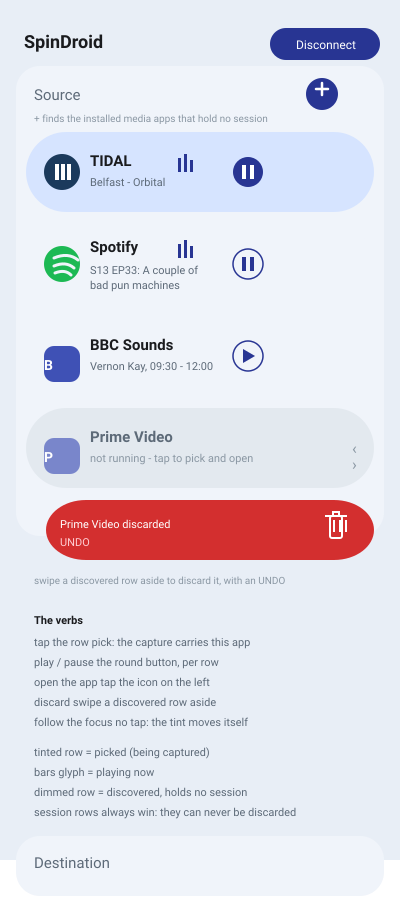

# The Source card row restyle

The Source card keeps its model and drops its radio buttons. The rows
become tinted, selectable rows, each row carries a handful of verbs
and two state marks, and a `+` finder brings the installed media apps
that hold no session. This plan covered the Source card alone when it
landed; the pattern is proven now, and the Destination card carries
the same swipe. Its rules live in
[two-card-ux.md](two-card-ux.md), behaviour 12.

## Why the radios go

A radio button is a form device: it records a choice that another
control commits. On the Source card the tap is itself the commit. A
stopped stream turns the tap into a staged pick for Connect, and a
running stream turns the same tap into an instant capture swap. A
control that sometimes records and sometimes acts should not look like
one thing. The tint says "this row is picked" without claiming a form.

## Discovery is opt in

Apps do not appear on the card by default. The card lists the apps
that hold a media session, exactly as today. A `+` icon button sits
right of the card title; it probes the installed apps for media player
services and merges the results into the list as dimmed rows, after
the session rows. The probe runs once per tap, not in the background,
so an app a user never asks for never appears.

The probe is the `MediaBrowserService` intent probe from the plan
[per-app-capture](per-app-capture.md) discussion; apps that currently
hold a session are left out of the results, because their real row is
already on the card.

## The verbs

1. **Pick.** A tap anywhere on the row picks the app, and the capture
   carries it. While the stream runs the tap swaps the capture filter
   of the running projection, as today. The pick is shown by the
   tinted row. The pick never opens the app, on a session row or a
   discovered one, so the focus follower can never pull an app to the
   front either. The icon on the row is the one control that opens.
2. **Play and pause.** The one round button on the trailing edge acts
   on the app's session. A playing row shows pause; a paused row shows
   play. A button appears only when the app supports it, so no row
   ever shows a dead control. Discovered rows carry no button, because
   they hold no session to act on yet.
3. **Open.** Tapping the app icon opens the app. This is the
   `getLaunchIntentForPackage` path; the app opens in the foreground,
   and whatever was playing keeps playing.
4. **Discard.** A horizontal swipe on a discovered row discards the
   app, the way an email app archives a message. The row leaves the
   list until the next `+` run, which brings every dropped row back;
   there is no undo affordance of its own (see the discard rules
   below).
5. **Follow.** No tap: the focus follower still moves the pick on its
   own, so the tint moves without a hand.

Capture and play stay separate verbs. A row tap never presses play
inside the app on its own, because a tap that starts sound in another
app is a bigger side effect than the tap seems to promise.

## The two state marks

- **Tinted row** means picked, which for the running stream means
  being captured. The tint and the follower agree, because both read
  the same pick.
- **The bars glyph** beside the label means playing now. Playing is
  the app's own state, and it changes without the screen doing
  anything, so it gets its own mark instead of borrowing the pick's.
- **Dimmed row** means discovered but not running: the probe found it,
  and it holds no session.

## The matrix

| App state            | Tint | Bars | Play  | Pause | Icon | Swipe |
| -------------------- | ---- | ---- | ----- | ----- | ---- | ----- |
| Playing, not picked  | -    | yes  | -     | yes   | yes  | -     |
| Playing, picked      | yes  | yes  | -     | yes   | yes  | -     |
| Paused, not picked   | -    | -    | yes   | -     | yes  | -     |
| Paused, picked       | yes  | -    | yes   | -     | yes  | -     |
| Buttons unsupported  | per pick | per play | hidden | hidden | yes | - |
| Discovered, no session | -  | -    | -     | -     | yes  | yes   |

## Discard rules

1. **Session rows can never be discarded.** An app that holds a
   session is a real, live source, and it won the place on the card
   fair and square. The swipe simply does not act on them.
2. **Sessions win over discards.** If the user discards an app and it
   later starts a session, its real row appears. The discard governs
   the `+` results only, never the live card.
3. **The plus forgets the drops.** A swipe hides a row only until the
   next `+` run: every run offers every installed media app again, so
   the plus is also the review of the buried. The drop lives in
   memory alone, because nothing outlives the next run.
4. **No undo.** The drop carries no snackbar and no button: the
   reversal is the `+` itself, which brings the whole list back one
   tap later. (An earlier draft showed an undo snackbar; the host
   never reached the screen, and the mockup never asked for one.)

## What does not change

- The pick is still one `packageName` per card, and Connect still
  enables when both cards carry a pick.
- The capture still filters by the picked app's uid, and a mid-stream
  pick still swaps the filter on the running projection.
- The focus follower still holds the pick while the picked app plays,
  while nothing plays, or while the pick has vanished, and still moves
  it when exactly one other app plays.
- The vanished pick keeps its status line under the bar; the card has
  no row for it, and needs none.
- Alphabetical row order, by label, as landed in `331d515`.

## The mock-up

## The open decisions

1. **Does Connect play the source?** Today Connect with a paused
   source starts the stream with silence, and the row's Play button is
   an obvious path to sound. Whether Connect should also press play on
   the picked app stays open; the row design keeps the two verbs
   apart, so the answer can stay deferred.
2. **The empty state.** With no sessions at all the card could show
   the `+` results right away instead of the help line, one tap
   earlier. Left open, because it changes the empty-state behaviour
   the screen already ships.
3. **A picker for the buried.** Resolved: the `+` itself is the
   review. Every run forgets the drops and offers every installed
   media app again, so no settings picker is needed.

## The test impact

The pick assertions in `TwoCardSteps` read the radio today
(`appIsPicked`, `appStaysPicked`). They retarget to the row's selected
state. The probe gets a seam, so the scenarios can inject a known
installed-app list instead of reading the real device. Discard is
drivable with the Compose swipe action, and the forget rule carries a
unit test. All 15 scenarios keep their wording.

## Related plans

- [two-card-ux.md](two-card-ux.md) holds the screen's behaviour
  contract, in particular behaviours 6, 8 and the row controls.
- [media-transfer-to-music-assistant.md](media-transfer-to-music-assistant.md)
  records the dropped content-transfer idea; the `+` finder is about
  sources, not about transfer.
