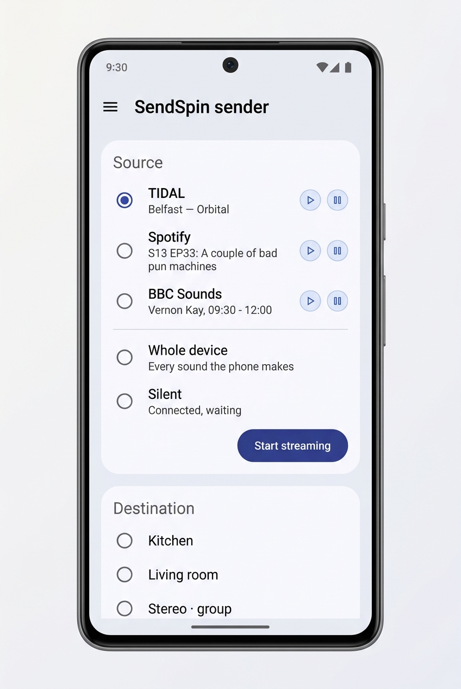
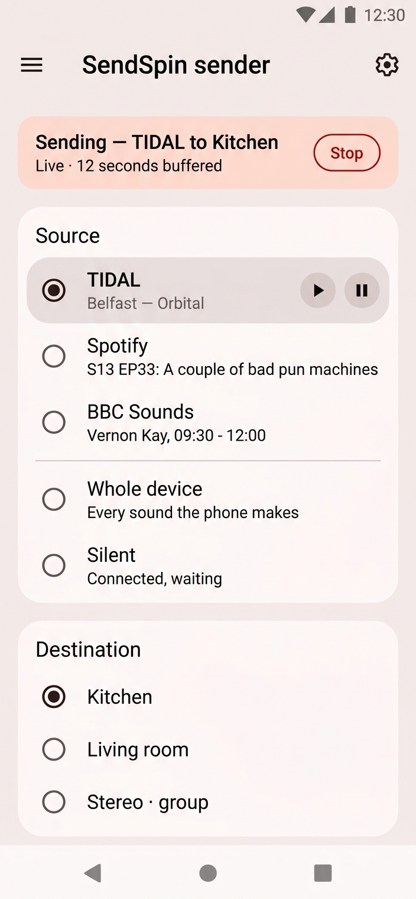
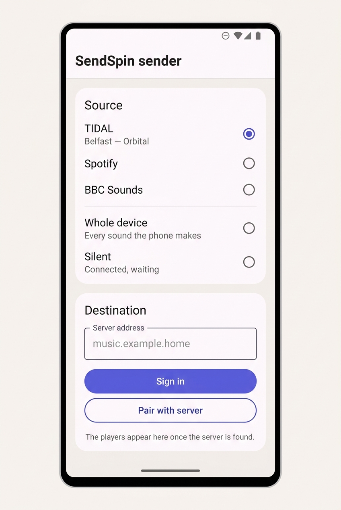
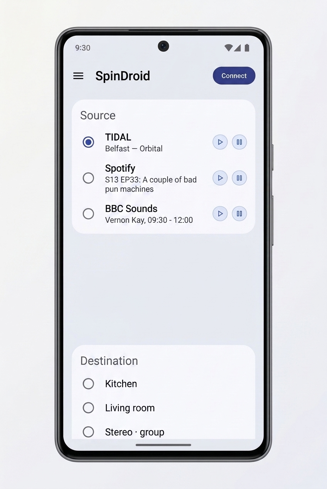
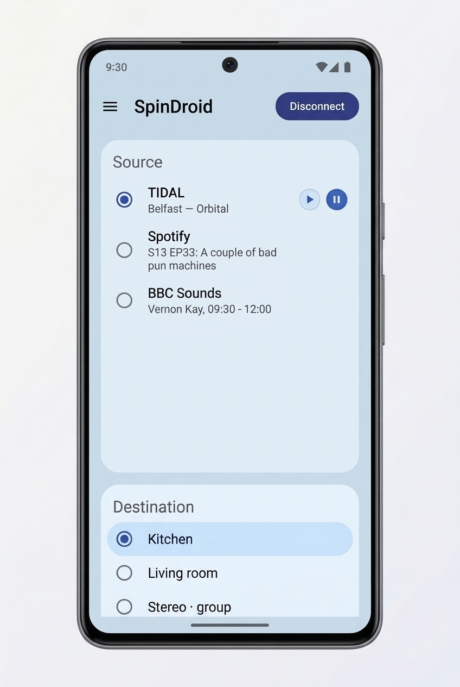
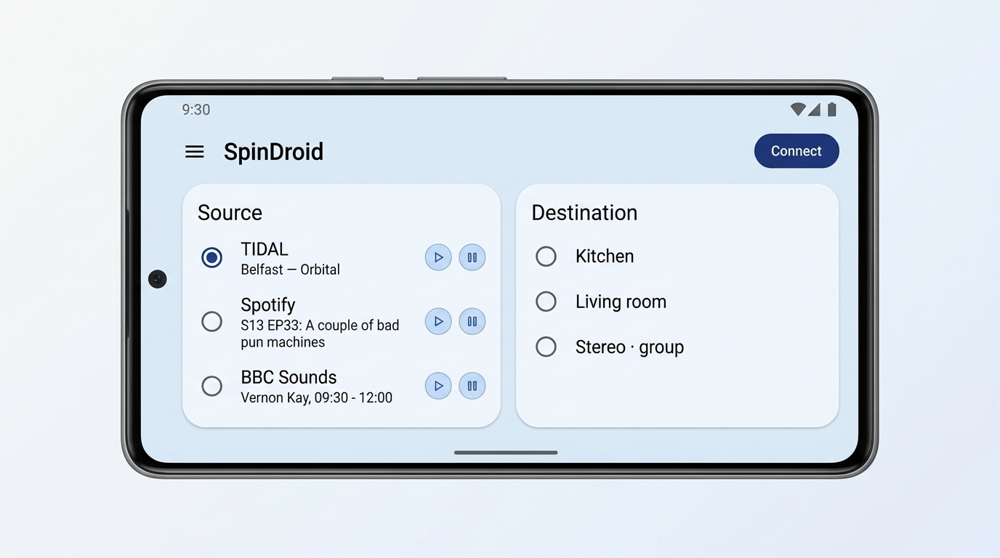
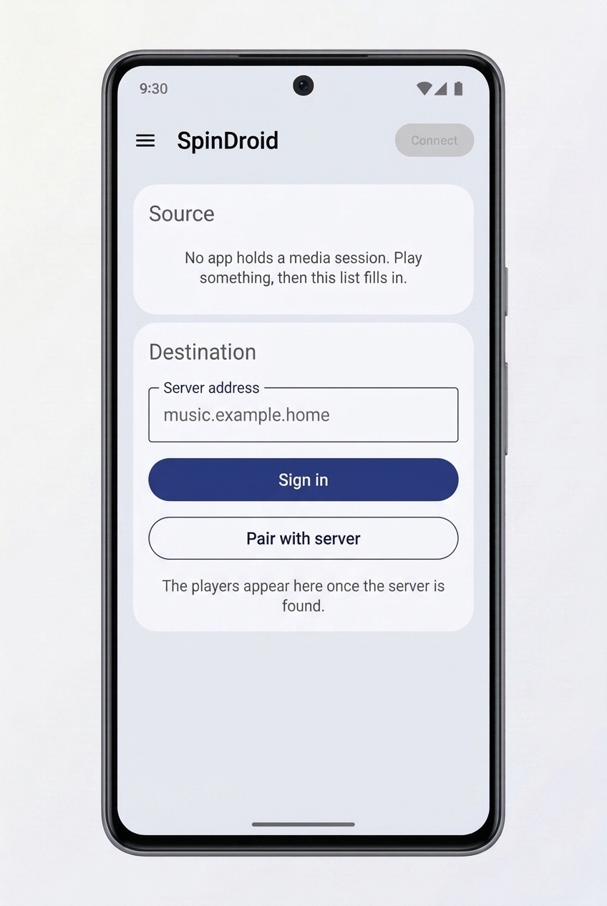

# The two-card sender UI

The primary screen of the sender is two always-present cards: a **Source**
card, which says where the audio comes from, and a **Destination** card,
which says which player the audio goes to. The product is streaming only:
the phone is a live audio input to the player network. Content transfer to
Music Assistant is discounted for now and stays out of every screen here.

The plan records the layout, the state model, the decisions still open,
and the mock-up route the design takes before any app work starts.

## The model

One source, one destination, streaming or not. Each card carries one radio
choice, so the whole app reads as a routing table:

1. **Source card.** The apps on the phone that hold a media session,
   playing ones first. Round 1's special entries, **Whole device** and
   **Silent**, were dropped in round 2; they live in round 1's mock-ups
   for the record.
2. **Destination card.** The players the network offers, one to a row.
   Before discovery works, the card holds the setup state instead of the
   list: the server address, sign-in, and pairing. Pairing is a separate
   grant with its own consent, so the setup state is a flow, not a row.

Each app row keeps the proven play and pause buttons beside its radio, so
the user can drive the app without leaving the card.

## The v1 flow

1. Open the app. The Destination card shows setup or the player list.
2. Pick a player. Pick one source app.
3. The **Connect** control in the app bar starts. The media projection
   consent dialog is the one confirm step.
4. The sending state: the selections and the Disconnect control carry
   the state, and the foreground notification carries Stop.
5. Change a source knowing the stream restarts and the consent dialog
   returns. Change the destination only after Disconnect in v1.

## Decisions still open

1. **The Connect control's meaning.** It stands for one action over both
   cards: connection to the network and the start of streaming. Whether
   the wording must say so is a round-3 question.
2. **Source switching mid-stream.** The capture filter belongs to the
   projection, so every source change needs a new consent dialog. The v1
   behaviour: restart straight away on the new pick and let the system
   dialog carry the friction.
3. **Destination switching mid-stream.** Cheap in theory and not free in
   our pipeline, which ends to end on one connection. Graduation item;
   the v1 rule is Disconnect first, then re-pick.
4. **Card order.** The flow picks a player first; the mocks keep Source
   on top because round 1 drew it so. Round 3 packs the cards tight and
   tests Destination above Source.
5. **A live list.** The source rows subscribe: `OnActiveSessionsChanged
   Listener` plus per-controller callbacks. A refresh button stops being
   acceptable once this is the primary screen.
6. **Teardown.** If the source app's session dies mid-stream, the state
   must say so; the auto-revert target changes with Silent dropped, and
   is open for round 3 (keep the stream with silence, or stop it).
7. **Multi-uid.** The capture filter supports several apps at once and the
   PoC proved it. The product offers one app only. Removing the middle
   ground is a deliberate v1 simplification, not an oversight.

## What dropping transfer simplifies away

No per-app transfer honesty table, no album, queue, or radio choices, and
no Spotify metadata-only caveats in the UI. The URI knowledge in the
metadata probe stays server-side. The Source card row needs no second
verb: selection plus a start control is the whole interaction.

## The mock-up route

1. **Static images first.** Screen mock-ups of the main states, iterated
   on wording and layout before any code. This is the current step. The
   first round is below.
2. **A tap-through mock.** A mock screen inside the app with hard-coded
   sources and players, wired to fake states, reached from the existing
   screen. No capture, no consent, no server.
3. **Real-but-thin wiring.** The same cards with the live session list
   and real discovery, with the capture trigger behind the new layout.
   The mock from step 2 becomes the skeleton; the throwaway part stays
   small.

## The mock-ups, round 1

The banner of the sending state reads best; the card anatomy is right.
The known issues for round 2, from the review:

1. Idle starts with TIDAL pre-selected and the start button live with no
   destination.
2. The card order contradicts the flow: the flow picks the player first,
   and the Source card sits on top and pushes the Destination card below
   the fold.
3. The start button belongs in its own full-width action below both
   cards, not inside the Source card.
4. Destination radios stay enabled while sending, which over-promises
   the stop-first rule.
5. The play and pause circles are oversized next to the row text, and
   the row tap area needs the buttons outside it.
6. The buffered-seconds line is a placeholder; the real metric comes
   from the protocol.
7. In the setup state, the Source card lists apps before any destination
   exists.

Round 2 resolved the banner, moved the start control to the **Connect**
pill in the app bar, and dropped the special source entries entirely.
Issues 2, 4, and 7 stay open and carry into round 3 with the points
listed there.

## The mock-ups, round 2

Round 2 keeps the style of `01-idle`. The user decisions it carries:

1. The app is **SpinDroid**.
2. **Whole device** and **Silent** are dropped; the Source card lists only
   apps with media sessions.
3. A **Connect / Disconnect** control sits in the top app bar, beside the
   title. Streaming state shows through the selections and the button,
   with no banner.

The trimmed Source list lets the landscape side-by-side split hold on a
phone. The open points carried to round 3:

1. Card order. The flow picks a player first; round 2 kept Source on top
   and the mock rendered a phantom gap between the cards. The next round
   packs the cards tight, and tests Destination above Source.
2. The Connect control's meaning. It stands for one action over both
   cards; if it means "start streaming the chosen route", the wording
   should say so.
3. Idle pre-selection. Idle shows TIDAL ticked from round 1; honest idle
   is nothing selected until the user picks.

## Feasibility

Every element of the mock-ups rearranges a proven part: the session list
and row controls come from the per-app capture PoC, the player rows and
the setup flow come from the Music Assistant screen, and Connect,
consent, and Disconnect are the existing capture start and stop. Only the
live subscription and the disabled-while-sending rule are new code. The
build order follows the mock-up route above, one card wired at a time.

## The behaviours

The behaviours live in [bdd/two-card-sender.feature](../bdd/two-card-sender.feature),
as Gherkin, in the style and harness the source feature already runs.
The list below is the same contract in plain terms. They are the
round-3 contract for the tap-through mock and then the wiring.

1. **Connect enabling.** The Connect control stays disabled until exactly
   one source row and one destination row carry a pick. It enables the
   moment both exist. A disabled Connect is not an error state; the cards
   themselves tell the user what is missing.
2. **Connect starts.** Connect with both picks shows the media projection
   consent dialog, then starts the capture and the stream to the picked
   player. The control reads Disconnect from that moment on, and the
   foreground notification carries the stop out of the screen too.
3. **Disconnect stops and keeps the picks.** Disconnect ends the capture
   and the stream. Both radio picks stay where they were, so a restart
   with Connect is one tap plus the consent dialog.
4. **Source change while sending requires Disconnect.** While Connect
   reads Disconnect, the Source radios are disabled. The v1 rule is stop
   first, then re-pick, then Connect again. (A future graduation item
   restores the radios and eats the consent dialog on the new pick.)
5. **Destination change while sending requires Disconnect.** Same rule
   for the Destination card, for the same pipeline reason.
6. **The list is live.** The Source rows subscribe to session changes.
   An app that starts a session appears; an app that drops its session
   leaves, mid-stream included, and behaviour 7 covers that case. No
   refresh button exists.
7. **Source teardown mid-stream.** If the picked app's session dies while
   the stream runs, the Source card shows the app's row as gone and a
   status line under the bar says the source vanished. The stream keeps
   sending silence to the player until Disconnect or a new pick. (The
   open question of stop-versus-silence is settled here as silence for
   v1; change it if a phone run says otherwise.)
8. **Empty states carry the next step.** No sessions: the Source card
   shows the help line. No players, or no server: the Destination card
   shows the setup flow. Both cards stay on screen in every state.
9. **Row controls drive the app.** Play and pause on a row act on that
   app's session and the row re-reads its state shortly after, as the
   PoC rows already do. They work whether or not the row is the pick.
10. **The layout adapts to width.** Portrait stacks the cards; landscape
    places them side by side. The state, the selections, and the Connect
    control are identical in both.

## Related plans

- [Per-app capture](per-app-capture.md) - the session list the Source card
  builds on, the uid filter, and the idle-app listing.
- [Media control](media-control.md) - the play and pause buttons that ride
  on the same session controllers.
- [Media transfer to Music Assistant](media-transfer-to-music-assistant.md)
  - the discounted transfer path, kept for the record.
- [Route publishing](route-publishing.md) - why the cards own the surface
  instead of the system output switcher.
- [The delayed speaker](delayed-speaker.md) - the delayed speaker feature,
  which round 1's Silent entry gestured at from the source side.
